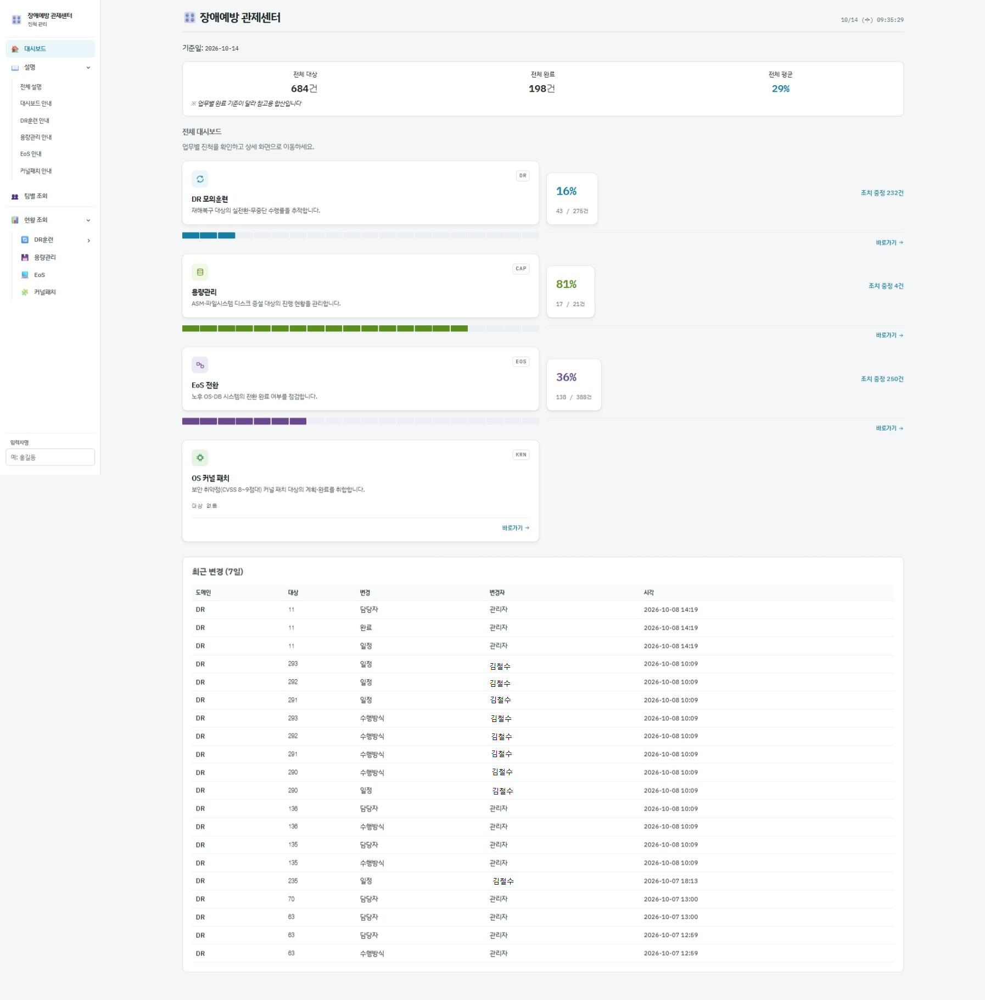
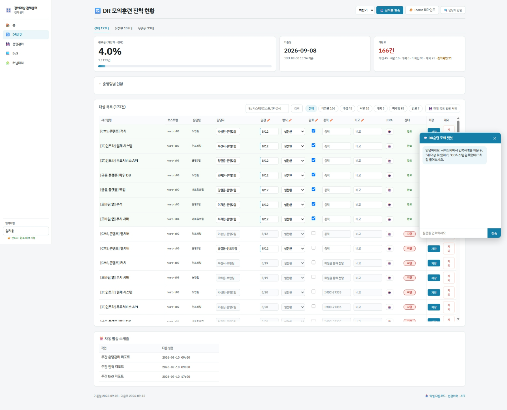
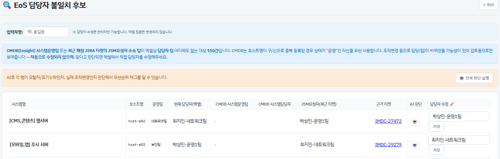
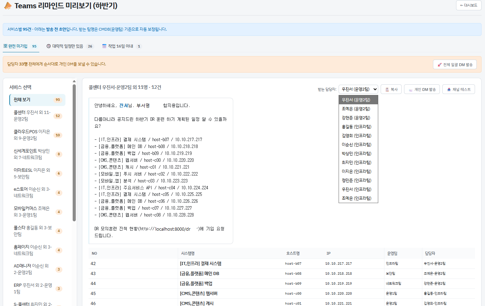

# prevention-tracker

> 인프라 장애예방 활동의 진척을 자동 집계하고, 주간 리포트를 Teams로 발송하는 사내 웹서비스.

엑셀과 JIRA에 흩어져 있던 장애예방 활동 현황을 한 화면으로 모으고, 매주 사람이 손으로 세던 진척률을 자동화했다. 4개 도메인 · 수백 대 규모 서버를 대상으로 실제 운영 중이다.

```
Python 3.12 · FastAPI · Jinja2 · SQLite · APScheduler · Kubernetes
```

<!-- 공개 전 이미지 전체의 실명·연락처·내부 주소·호스트명·토큰을 확인하고 마스킹한다. -->



---

## 왜 만들었나

장애예방 활동(DR 모의훈련, 디스크 증설, 노후 OS 전환, 보안 패치)은 **대상 목록은 엑셀에, 실제 수행 근거는 JIRA 티켓에** 있었다. 매주 진척을 보고하려면 담당자가 두 자료를 눈으로 대조해야 했고, 그 과정에서 세 가지 문제가 반복됐다.

- **집계가 사람마다 달랐다.** "계획일이 지났으니 됐겠지"로 세면 실제 수행치보다 크게 부풀려진다.
- **대조가 오래 걸렸다.** 티켓 제목·본문에 적힌 호스트명/IP를 수백 건 눈으로 맞춰야 했다.
- **근거가 남지 않았다.** 왜 완료로 쳤는지, 왜 대상에서 뺐는지가 보고서에만 있고 데이터에는 없었다.

이 서비스는 세 문제를 각각 **판정 규칙의 코드화 / 자동 매칭 / 근거와 이력의 영속화**로 풀었다.

---

## 관리 대상

| 도메인 | 내용 | 완료의 근거 |
|---|---|---|
| **DR훈련** | DR 모의훈련 (실전환 / 무중단) | 해당 반기 JIRA 티켓 |
| **용량관리** | 임계치 초과 디스크 증설 (DATA / ARCH) | 증설 완료 티켓·표기 |
| **EoS** | 노후 OS/DB 전환 | CMDB 자산명 `_OLD` 전환 ∪ JIRA 티켓 |
| **커널패치** | 보안 취약점(CVSS 8~9점대) 커널 패치 | Polestar REST 뷰 우선 ∪ 실패 시 엑셀 폴백 ∪ 관리자 확인 |

---

## 화면

모든 화면은 같은 왼쪽 메뉴를 사용한다. **팀별 조회는 독립 메뉴**, 현황 조회는 기본 펼침, 설명 메뉴와 설명 본문은 접기/펼치기를 지원한다.

```text
대시보드
설명 ▸ 전체·업무별 이용 안내
팀별 조회
현황 조회 ▾
  ├ DR훈련 ▸ 진척 현황 · 반기 비교 · Teams 리마인드 · 담당자 확인 · 변경 이력
  ├ 용량관리
  ├ EoS
  └ 커널패치
```

- **대시보드**: 기준일, 업무별 완료율, 참고용 완료/대상 합산, 업무별 조치 바로가기, 최근 7일 변경 목록을 보여준다. 합산은 고유 서버 수가 아니며 업무 간 중복 대상이 있을 수 있다.
- **최근 변경**: DR훈련·용량관리·EoS의 변경 이력을 모은다. 커널패치는 별도 변경 로그 테이블이 없어 이 목록에 포함하지 않는다.
- **DR 상세 목록**: 상태·조치 필터를 통합해 실제 조회 범위의 대수를 표시한다. 필터 기억하기를 선택하면 팀·검색어·반기·수행방식 등을 현재 브라우저에 저장하며 초기화할 수 있다.
- **상·하반기 비교**: 반기별 수행방식·완료 상태·증적을 나란히 확인한다. 최근 변경 표시와 감사 이력은 완료율 계산과 분리한다.

<!-- ┌─ 스크린샷 자리 ─────────────────────────────────────────────────┐
     docs/screenshots/ 에 아래 이름으로 넣고, 해당 줄의 주석만 풀면 된다.
     마스킹 기준은 docs/screenshots/README.md 참고.-->


> 표에서 바로 편집 · 상태별 필터 · 변경이력 자동 기록


> 엑셀 담당자와 CMDB 등록 담당자 대조, 오탈자/조직변경 AI 분류


> 발송 전 팀별 초안 확인 후 Teams DM
<!--
     └──────────────────────────────────────────────────────────────┘ 
-->
---

## 아키텍처

```
   ┌─ 엑셀 (반기 대상 목록, 원본)
   ├─ JIRA REST        (변경 티켓)
   ├─ JIRA Insight     (CMDB 자산·담당자)      ┌──────────────┐
   ├─ Confluence REST  (주간 작업계획 PDF)  ──→ │ 매칭 · 판정   │──→ 대시보드
   └─ Polestar (EMS)   (CI 상태)              └──────┬───────┘     주간 Teams 리포트
                                                     │              담당자 DM
                              SQLite ────────────────┘
                     (웹 입력값 · 변경이력 · 관측기록 · 발송 스냅샷)
```

**엑셀은 읽기 전용 원본이고, 웹 입력은 SQLite에 별도로 저장해 병합한다.** 원본을 건드리지 않으므로 엑셀이 교체돼도 웹 입력이 살아남고, 파일 수정시각이 바뀌면 다시 읽는다. 단, DR 하반기 수행방식은 수동 입력보다 상반기 결과로 계산한 규칙이 우선한다.

```
app/
├── core/       외부 연동 클라이언트 · 엑셀 로더 · 스케줄러
├── services/   판정 · 매칭 · 리포트 · 캐시 · 화면용 계산
├── models/     SQLite 스키마와 접근
└── web/        FastAPI 라우트 · Jinja2 템플릿 · 정적 파일
```

---

## 설계에서 다뤄야 했던 것들

### 1. "완료"의 정의가 도메인마다 다르다

가장 많은 시간을 쓴 부분이다. 네 도메인이 각자 다른 근거를 쓰기 때문에 판정을 하나로 합칠 수 없었고, 대신 **판정 함수를 도메인별로 분리하고 상태 표기(완료/예정/지연/대략/미계획)와 정렬 규칙만 공유**했다. 화면을 오가는 사람이 도메인마다 다른 규칙을 외우지 않아도 되게 하려는 의도다.

일관되게 지킨 원칙이 하나 있다 — **계획일 경과를 완료로 보지 않는다.** 초기 구현에는 "일정이 지나면 완료" fallback이 있었는데, 실제 수행치보다 부풀려져 제거했다.

EoS는 근거가 둘의 합집합이다.

- JIRA `작업 완료(CMDB)` 필드에 `_OLD`로 끝나는 자산이 달린 티켓 (Insight Key로 정확 매칭)
- Polestar에서 CI 이름이 `_OLD`로 바뀐 대상 (전환 완료 시 AS-IS 자산명에 붙는 규칙)

반려·중단·종료 상태의 티켓은 근거에서 제외한다.

### 2. 사라지는 근거 — 관측 래치

EoS 전환이 끝난 AS-IS 서버는 한동안 `_OLD`로 남아 있다가 **결국 폐기되어 CMDB에서 사라진다.** 판정은 매번 "지금 상태"를 다시 보기 때문에, CI가 지워지는 순간 완료 근거도 같이 사라져 **완료 대수가 뒤로 가는** 문제가 있었다.

판정 결과가 아니라 **관측 사실을 날짜와 함께 적재**해서 풀었다.

```python
# eos_polestar_seen(item_no, reason, first_seen, last_seen)
"present": True if current is None else (item_no in current)
```

조회 자체가 실패했을 때(`current is None`)와 조회는 됐는데 대상이 없을 때를 구분한다. 전자를 폐기로 오인하면 외부 시스템이 잠깐 죽을 때마다 완료율이 출렁인다. 오탐이었다면 관리자가 관측 기록을 지울 수 있고, 다음 조회에서 다시 보이면 재기록된다.

같은 패턴을 DR 제외 처리에도 적용했다. 제외 확정된 대상의 완료 인정일은 **반기 종료일과 제외 처리일 중 늦은 쪽**이다 — 반기 도중에는 아직 미완료로 남겨야 하고, 반기가 끝난 뒤 새로 제외한 건을 소급하면 이미 나간 결산 숫자와 어긋난다.

### 3. 외부 시스템이 느리다 — SWR + 병렬화

대시보드 한 번 여는 데 JIRA 수백 건 조회 + CMDB 대조 + Polestar 조회가 필요해 **첫 화면까지 15초 이상** 걸렸다.

**stale-while-revalidate + single-flight**로 바꿨다. TTL이 지나도 일단 있는 값을 즉시 돌려주고 갱신은 뒤에서 돌린다. 같은 키에 대한 동시 갱신은 락으로 한 번만 실행되어, 캐시가 비는 순간 요청이 몰려도 외부 호출이 중복되지 않는다. 서버 기동 시 미리 채워두므로(prewarm) 사용자가 cold를 만나는 경우는 사실상 없다.

```
EoS 대시보드    cold 15.27s  →  warm 0.035s
```

JIRA 조회 자체도 **첫 페이지로 전체 건수를 받은 뒤 나머지 오프셋을 병렬 요청**하도록 바꿔 15.4s → 2.8s가 됐다. 최적화 전후로 **티켓 집합과 필드가 동일한지 확인한 뒤** 반영했다.

> 이 과정에서 한 번 실패했다. 매칭 로직을 "코퍼스 스캔" 방식으로 바꿨더니 오히려 느려져서(8.76s → 10.67s) 되돌리고, 공백 토큰 색인 방식으로 다시 짰다. 결과가 바이트 단위로 동일한지 도메인별로 검증한 뒤 채택했다.

### 4. 티켓과 대상을 잇기

티켓 본문에 적히는 식별자가 제각각이라 **IP / 호스트명 / CMDB Insight Key** 세 가지를 쓴다. EoS는 Key 매칭을 우선하고 그 필드가 없는 티켓만 IP·호스트명으로 보강한다.

DR훈련은 본문 텍스트를 쓰지 않고 **티켓의 작업 대상 CMDB 필드(`DR_CMDB_TARGET_FIELD`, "CI명 (Key)")로만** 연결한다. 변경작업 대상에 IP가 빠지거나 약칭만 적힌 티켓을 놓쳤기 때문이다. 대상 엑셀에는 Key가 없어 호스트명으로 CMDB 자산을 찾은 뒤 Key 또는 CI명(완전 일치)으로 맞춘다 (`app/services/dr_match.py`). 필드가 설정되지 않으면 0건으로 조용히 넘어가지 않고 조회 오류로 표시된다.

매칭이 안 된 건에 대해서는 "왜 안 됐는지"를 AI로 진단하는 버튼을 뒀다. 사람이 티켓을 열어보지 않고도 오탈자인지, 티켓이 실제로 없는지 판단할 수 있다.

### 5. 반기가 넘어가도 대상을 잃지 않게

기존의 고정 모수·참고 목록 분리를 없애고, **하반기 전체 대상의 수행방식을 상반기 결과에 따라 계산**한다. 실제 대수는 현재 엑셀의 대상 여부와 웹 입력에 따라 달라진다.

| 상반기 수행방식 | 상반기 완료 여부 | 하반기 수행방식 |
|---|---|---|
| 무중단 | 완료·미완료 모두 | 실전환 |
| 실전환 | 완료 | 무중단 |
| 실전환 | 미완료 | 실전환 |

상반기 완료 여부는 기존 `calc_completion` 판정을 사용한다. 대시보드와 리포트는 `dr_data.compute_h2_items()`를 공유하며, 상반기 이력이 없는 대상은 하반기 엑셀의 수행방식을 유지한다. **상반기 방식은 수동 입력 가능하지만, 하반기 방식은 계산값을 우선**한다.

하반기 증적은 엑셀의 상·하반기 공용 `증적` 값을 이어받지 않고, `half='H2'`로 저장한 웹 입력값을 사용한다. 무중단 JIRA 후보는 제목의 `무중단`과 이슈 유형 `서비스요청관리`를 함께 확인한다. 실전환은 변경계획완료일, 무중단은 생성일을 해당 반기 창과 비교한다. 증적 입력 및 티켓 상태 경고는 완료 판정 자체와 구분된다.

### 6. 잘못된 숫자가 나가지 않게

리포트는 정기 발송이라 한 번 나가면 되돌릴 수 없다. 발송 직전 **지난 발송분(`report_snapshot`)과 비교해 이상 징후를 규칙으로 감지**한다 — 완료 대수 감소, 진행률 급변, 전체 대상 변동. 감지는 코드가 하고 **해석만** AI가 맡는다.

이상이 있어도 발송을 막지는 않는다. 정기 보고를 거르는 쪽이 더 큰 문제라, 경고를 로그와 화면에 남기고 보낸다.

---

## 주간 리포트

목요일 자동 발송 (`.env`로 조정).

| 리포트 | 시각 | 비고 |
|---|---|---|
| DR훈련 · 용량관리 | 09:00 | |
| EoS | 17:00 | 담당자가 목요일 중 주간계획을 작성하므로 그 이후 |

Teams 워크플로가 개행을 렌더링하지 않아, 평문과 함께 `<br>`로 변환한 HTML 본문을 같이 실어 보낸다.

---

## AI를 쓴 방식과 쓰지 않은 곳

**계산·판정은 전부 코드가 한다.** AI는 서술과 해석만 맡는다. 목록을 자유 생성시키지 않고 **후보를 주고 고르게** 해서 없는 시스템을 지어내는 것을 막았다.

| 용도 | 성격 |
|---|---|
| 주간 특이사항 요약 | 서술 |
| 매칭 실패 원인 진단 | 해석 |
| 리포트 이상 징후 해석 | 해석 |
| 담당자 불일치 판단 (오탈자 / 조직변경) | 분류 |
| 진척 조회 챗봇 (도메인별) | 조회 |

에이전트 키가 없으면 **해당 기능만 조용히 생략되고 나머지는 정상 동작한다.**

---

## 그 밖의 기능

- **인라인 편집** — 일정·완료·증적·비고·담당자를 표에서 바로 수정, 변경이력 자동 기록
- **권한 분리** — 입력자명이 관리자 목록에 있을 때만 완료 체크·제외 처리·수동 발송 노출
- **제외 처리** — 수행하지 않기로 확정된 대상을 사유와 함께 분리, 복귀 가능
- **미계획 리마인드** — 일정 미등록 담당자에게 Teams DM (미리보기 후 발송)
- **리마인드 분류** — 실전환/무중단과 완전 미기입/대략적 일정/사전 안내를 나누어 조회한다. 사전 안내 기간은 `PRE_WORK_REMIND_DAYS` 설정을 따른다.
- **관리자 표시 분리** — 감사 로그에는 실제 수정자를 보존하되 화면에서는 관리자 이름을 가린다. 리마인드 입력자 판단에서는 관리자를 제외하고 담당자 기준으로 처리한다.
- **담당자 확인** — 엑셀 담당자와 CMDB 등록 담당자 대조
- **엑셀 내보내기 / 조회 API** — 도메인별 제공

---

## 실행

```bash
cp .env.example .env      # 각 값 채우기
pip install -r requirements.txt
uvicorn app.main:app --reload
```

```bash
python -m pip install -r requirements.txt -r requirements-dev.txt
python -m pytest -q
```

커널패치 수집은 Polestar 구성정보 웹 그리드를 우선 사용한다. 로그인 계정은 읽기 전용 전용 계정을 권장하며,
비밀번호는 `.env` 또는 Kubernetes Secret으로만 주입한다. 이 기능은 Playwright Chromium을 사용하므로 배포 이미지 빌드 시
브라우저와 OS 의존성이 설치된다. 인증정보와 브라우저 세션은 로그/디스크에 저장하지 않는다.
`CMM_RESOURCE.versios` 및 확인한 Elasticsearch 인덱스는 화면의 현재 커널값 소스로 확인되지 않았다.

필수 설정(환경변수 이름은 대소문자 무관):

```dotenv
KERNEL_POLESTAR_WEB_USER=readonly_user
KERNEL_POLESTAR_WEB_PASSWORD=<secret>
KERNEL_POLESTAR_WEB_LOGIN_PATH=/ko/account/login
KERNEL_POLESTAR_WEB_GRID_PATH=/ko/management/configuration
```

선택 기능이며 계정 값이 없으면 REST/엑셀 경로를 유지한다. 웹 화면에서 `PQL 검색`을 열고 서버 타입을 선택해 검색한 후
Wicket 그리드를 모든 페이지 순회한다. `ipaddress`와 `patchlevel`을 매핑하며 (`name`은 화면 표시명이므로 hostname으로 가정하지 않는다),
같은 IP에서 서로 다른 커널값이 발견되면 충돌 방지를 위해 해당 IP를 제외한다. 대상 엑셀과 매핑되지 않은 서버는 완료 판정하지 않는다.
`KERNEL_POLESTAR_VIEW`와 `KERNEL_PATCHED_EXPORT_PATH`는 웹 그리드 수집 실패 시 보조/폴백 용도다.

`KERNEL_POLESTAR_VIEW`는 이전 REST 뷰 연동용 호환 설정이다. 실제 실행 커널 컬럼을 제공하지 않으면 웹 그리드 수집이 우선이며,
ES `metric_recent`/`resource_search` 인덱스는 OS 커널 패치 버전 소스로 확인되지 않았다.

`.env`는 gitignore 대상이며 인증정보·에이전트 키가 모두 여기 들어간다. Kubernetes 배포 시 **Secret과 코드를 반드시 함께 갱신해야 한다** — 한쪽만 배포되면 설정 로딩에서 실패하거나, 더 나쁘게는 필드 ID가 비어 조용히 잘못된 숫자가 나간다.

---

## CI/CD

워크플로우는 [`.github/workflows/ci-cd.yml`](.github/workflows/ci-cd.yml)에 정의되어 있다. **main 대상 PR과 main push 모두** `pr-checks`, `image-scan`을 병렬 실행한다. 배포는 두 잡이 통과한 main push에서만 실행한다.

```
PR / main push
  ├ pr-checks: Gitleaks → pytest → Python 문법 검사 → pip-audit → Trivy config
  └ image-scan: Docker 빌드(dr-tracker:ci) → Trivy image

main push + 두 검사 잡 성공
  → self-hosted 러너에서 배포 이미지 빌드
  → GHCR push (latest 및 커밋 SHA 태그)
  → Kubernetes namespace/PVC/service/deployment 적용
  → rollout restart → rollout status 확인 (120초 제한)
```

Gitleaks는 체크아웃한 Git 이력에서 비밀정보를 검사한다. pip-audit은 `requirements.txt`의 의존성을 검사한다. Trivy config는 저장소의 설정을, Trivy image는 OS/Python 패키지 취약점을 검사한다. Trivy는 HIGH/CRITICAL 발견 시 실패하며 이미지 검사는 수정 버전이 없는 취약점을 제외한다(`ignore-unfixed: true`).

검사용 이미지와 배포용 이미지는 서로 다른 잡에서 **별도로 빌드**한다. 현재 워크플로우는 검사한 이미지의 digest를 그대로 배포하는 구조가 아니며, rollout 성공이 모든 업무 화면의 정상 응답을 보장하지는 않는다.

GHCR 이미지는 현재 public으로 운영해 Kubernetes가 익명으로 pull한다. **push에는 여전히 `GITHUB_TOKEN`과 `packages: write` 권한이 필요**하다. Private 이미지로 전환할 경우에는 별도의 유효한 pull 자격증명과 갱신 정책이 필요하며, 실행이 끝나면 만료되는 워크플로우 토큰을 장기 pull Secret으로 사용하면 안 된다. 운영 데이터는 볼륨, 인증정보는 Secret으로 주입하고 이미지에는 포함하지 않는다.

## 공개 자료와 민감정보

- 스크린샷은 실명·담당자명·연락처·내부 주소·호스트명·티켓 내용·토큰을 확인하고 불투명 마스킹한 최종 이미지로 게시한다. 테스트용 데이터로 캡처하는 것을 권장한다.
- **Gitleaks/Trivy는 스크린샷 속 개인정보를 자동으로 검출·차단한다고 보장하지 않는다.** 이미지 공개 전 육안 검수가 필요하다.
- 이미 push한 민감 이미지는 새 캡처로 교체해도 과거 커밋에 남는다. 이력 정리가 필요하면 노출된 버전과 참조 범위를 먼저 확인하고, 공동 작업자와 조율하여 최소 범위로 재작성한다. GitHub의 캐시·PR 참조는 별도 지원 요청이 필요할 수 있으며, 이미 내려받은 복사본까지 회수할 수는 없다.
- 토큰·비밀번호가 노출됐다면 이력 정리에 앞서 폐기·재발급한다. 개인정보 노출은 조직의 보안·개인정보 대응 절차를 따른다.

---

## 알려진 한계

- **커널패치 외부 연동은 운영 검증 전 단계다.** 앱은 `/rest/measure/vt/{view}/all` 형식의 Polestar REST 뷰를 우선 사용하고, HTTP/JSON/페이로드 오류나 유효 버전 0건일 때만 엑셀로 폴백한다. 자동 후보 탐색은 하지 않으며 실제 EMS/Oracle 연결은 테스트에서 모킹으로만 검증한다.
- **엑셀이 계약이다.** 컬럼명이 바뀌면 로더를 고쳐야 한다. 머리글은 별칭 집합으로 찾아 어느 정도 흡수하지만 완전하지 않다.
- **자동화 테스트의 범위.** pytest로 JIRA 페이지네이션·잘린 응답 처리, 매칭, H1/H2 규칙, 필터, 리마인드, 관리자 표시, 대시보드 집계·템플릿 렌더링을 검증한다. 외부 연동은 모킹으로 대체하므로 실제 JIRA/Polestar/Confluence 통신이나 브라우저 시각 동작까지 보장하지 않는다. 테스트에는 임시 엑셀·DB를 사용하고 운영 `data/`와 `.env`에 의존하지 않아야 한다.
